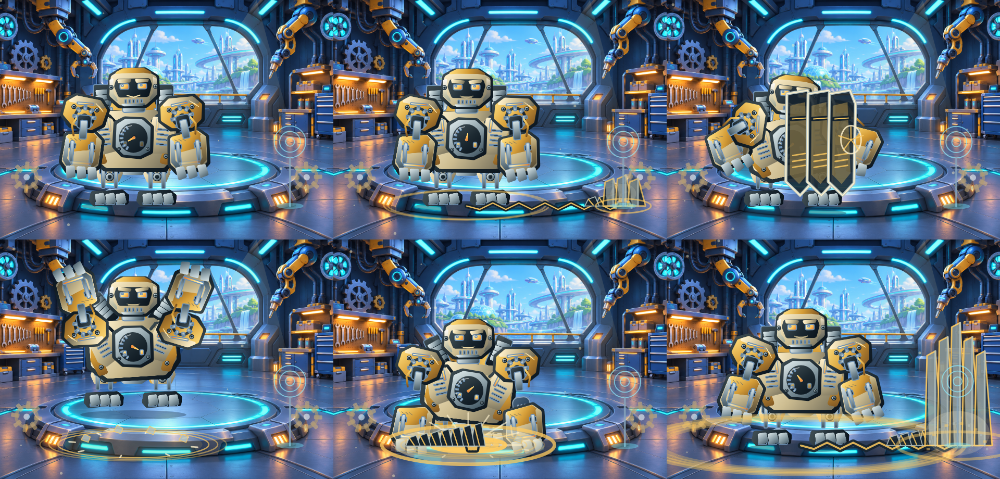

**Robo Workshop · Титан, осадный колосс · 0.2.0 (42), тест**

Титан получил новый силуэт: широкий низкий бронекорпус, длинные руки-копры, телескопические поршни, тяжёлые опорные ноги и компактный шлем с двумя янтарными глазами. Броня разделена на объёмные плоскости с фасками, крепежом, швами и следами обработки. Механический манометр, контрмаховик, радиаторы, кулаки и гидравлика ног движутся независимо. Палитра — слоновая кость, тёмная сталь и охра.

В редактируемом RML — 396 фигур, 518 узлов, 198 уникальных путей и 173 материала. Портрет коллекции и нативная геометрия получены из этого же источника. Изменены только артборд и модель данных Титана; остальные 31 робот, включая Вольта, сохранены. Общий опубликованный Rive-файл не заменяется: Титан в основной игре использует локальный CustomPainter с кешированием статических механических сборок.

| Действие | Анимация |
| --- | --- |
| Обычная атака | Подготовка веса, выдвижной удар правым кулаком, отдача и восстановление |
| Быстрый | Тяжёлый выпад с работой опор и следом пыли |
| Навык | Два копра ударяют по земле; разлом проходит к цели и поднимает каменные осколки |
| Защита | Три броневые секции собираются в высокий бастион; попадание даёт деформацию стойки и металлическую вспышку |
| Уворот | Перенос веса, выраженный боковой шаг и след пыли |
| Фокус | Руки сходятся у двигателя давления, манометр и радиаторы показывают заряд |
| Супер «Сейсмический удар» | Опоры, раскрутка механизма, подъём обеих рук, удержание напряжения, тяжёлое приземление, несколько ударных волн и высокие каменные плиты под целью |
| Победа | Удары кулаками в грудь, подъём рук, металлические искры и победная музыка |
| Поражение | Падение давления, проседание опор, пар, погасшие глаза и остановка механизмов |

Всего предусмотрены 18 последовательностей, включая радость, прыжок, удивление, недовольство, танец, осмотр, приветствие, игровую реакцию и кормление. Касания выбирают реакции без повторов до исчерпания набора, частые нажатия вызывают недовольство. Взгляд следует за пальцем, выбор точки запускает движение. Переходы смешивают отдельные механические каналы. Экипированный модуль остаётся видимым и использует собственную точку выстрела и звук. В осмотре доступны десять кнопок, в том числе для закрытого персонажа; демонстрации не расходуют ресурсы.

Супер длится 3,35 секунды в осмотре. В бою позы привязаны к существующим фазам хода: выпуск на 0,62, попадание на 0,90 нормализованной последовательности. Урон, отражение, стоимость действий, противники и серверные правила не менялись. Сейсмический разлом и броневой бастион дают Титану собственный визуальный язык.

Добавлены восемь оригинальных синтезированных звуков: гидравлика, удар, шаг, давление, раскрытие бастиона, землетрясение, гул и отключение. Использованы генераторы и детерминированный шум; чужие записи не использовались. Все 49 прежних аудиофайлов сохранены. Начала звуков привязаны к фазам движения и проверяются при 30, 60 и 120 Гц. Музыка использует прежний постоянный контроллер.

По запросу обновлены Python-пакеты Flet, CLI, Desktop, Web, Ads и Rive до 1.1.2, Flutter — до 3.47.9, Dart — до 3.13.7. Обновлены совместимые зависимости и lock-файлы. Нативные расширения, основной клиент и проверки мигрированы на `material_ui`; тональные поверхности темы сохранены явно. Некоторые новые версии транзитивных пакетов остаются за пределами ограничений Flet — принудительные несовместимые подмены не применялись. Использована [официальная инструкция Flet](https://flet.dev/docs/updates/breaking-changes/v1-1-0/material-ui-cupertino-ui/).

Смена Flutter дала небольшие отличия сглаживания от старых PNG. Для проверки сохранности Вольта исходники опубликованного v39 отдельно собраны на том же новом движке, с заменой только импортов Material. Текущий Вольт совпал с этими контрольными кадрами пиксель в пиксель. Прежние эталоны сохранены; происхождение новых фиксируется в численном отчёте.

Прошли 389 нативных тестов Flutter, включая компоновки экранов и демонстрации всех 32 персонажей. Из 299 Python-проверок 289 успешны, 10 необязательных PostgreSQL пропущены. Анализ обоих Flutter-расширений не выявил замечаний. Проверка области изменений подтверждает сохранность остальных артбордов, портретов, способностей, старого аудио, боевых правил и кода сохранений.

Для статичных деталей используется отдельный кеш текстур с плотностью 3 пикселя на единицу геометрии и консервативным бюджетом 16 МиБ. Суставы, поршни, лицо и активные механизмы продолжают двигаться независимо. Кеш освобождается при нехватке памяти. Реализация использует [API Flutter для растеризации сборок](https://api.flutter.dev/flutter/dart-ui/Picture/toImageSync.html). Проверены 120 кадров без повторного создания текстур, смена 12 оттенков и очистка памяти. Среднее отличие от прямой векторной отрисовки в пяти контрольных позах — 0,26–0,34 по шкале RGBA 0–255; отклонение контура меньше 1%.

В первом прогоне с векторным кешем медианы FPS были: мастерская 118,8 → 87,5; бой 90,7 → 66,2; супер 71,1 → 79,2. Эти результаты сохранены в отчёте. После добавления кеша текстур выполнен второй полный парный прогон:

| Сцена | Старый Титан v39, медиана | Новый Титан v42, медиана | Минимум нового |
| --- | ---: | ---: | ---: |
| Мастерская | 119,1 | 116,4 | 82,2 |
| Бой | 101,3 | 87,0 | 72,5 |
| Демонстрация супера | 99,3 | 89,4 | 73,4 |

Это Windows/Chrome profile: мастерская и осмотр 390×844 DPR 3, бой 844×390 DPR 2. В каждой паре одинаковые обновлённые Flet 1.1.2 / Flutter 3.47.9, шрифты и сценарии; сравнивается прежний Rive-Титан с новым нативным Титаном. В каждом захвате 25–26 окон после прогрева; ошибки Flutter отсутствуют. Первый нативный кадр: мастерская 1,223 → 0,589 с, бой 1,078 → 1,289 с, осмотр супера 1,389 → 0,729 с. Замеры имеют разброс и перекрывающиеся окна; это показатели настольного клиента.

В реальной основной игре проверены касания: пять коротких нажатий дали пять наград, пол и долгое удержание — ноль; автоматическое кормление сохранилось. Музыкальный наблюдатель подтвердил две завершённые победные композиции, одну фоновую дорожку, плавное изменение громкости, сохранение позиции после паузы и запуск `titan_quake.wav`. Исправлен приоритет библиотек проекта в дочерних процессах: системный Flet 1.0.4 больше не перекрывает Flet 1.1.2 из `.venv`. Клиент обычного Run пересобран, его контракт соответствует текущим исходникам.

APK 0.2.0 (42): 182 439 137 байт, на 4 536 711 байт больше v39. Проверены прежняя подпись, три ABI, 128 нативных библиотек с 16-КБ выравниванием, 49 модулей Python 3.14.10, все 57 аудиофайлов и портрет Титана в самом APK. Публичный HTTPS сервера отвечает с версией правил 3. Сборка содержит тестовые объявления. SHA-256: `89dfec6e0011e24a6daf9ff930902125fdef7578d64bcaf3300dc4d47678ffc8`.

На физическом Android ещё требуется проверить плавность, нагрев и звук динамика: подключённого устройства нет. Численные результаты APK, воспроизведения, касаний и настольных замеров: [verification.json](docs/titan-v42/verification.json).

Проверка на телефоне: установить тестовый APK поверх v35–v39, открыть Титана в коллекции и осмотре, попробовать все десять кнопок, затем тренировочный бой. У навыка разлом идёт по земле; у защиты раскрываются броневые секции; у супера после подготовки должны быть видны тяжёлое приземление и выброс плит. Проверить также уменьшенные эффекты и экипированное оружие. [Тестовый релиз](https://github.com/499jdkd/Robo-Workshop-Steel-Arena/releases/tag/titan-v0.2.0-42).
