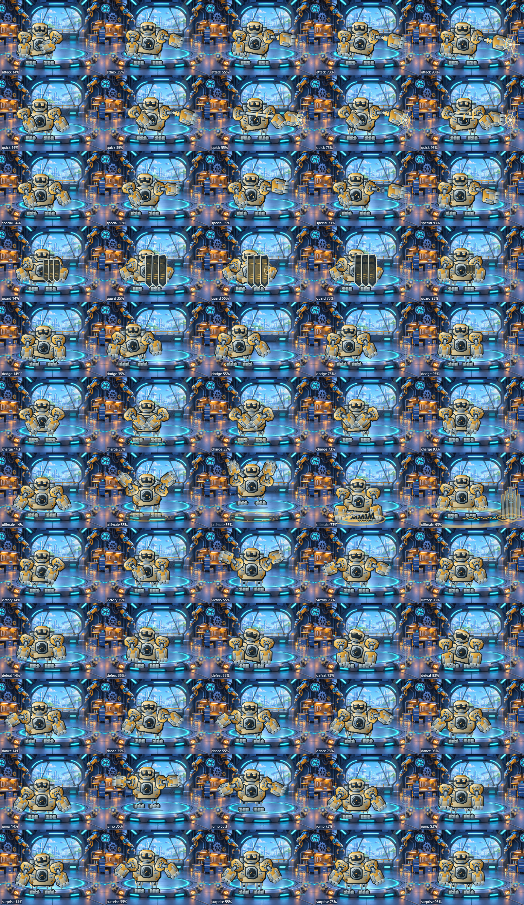
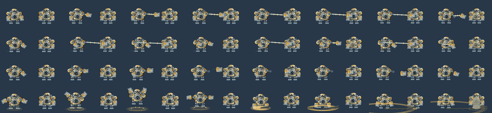

# Титан v43: разные атаки и волна через противника

Навык Титана больше не повторяет сейсмический супер. Настоящий правый кулак отстыковывается от руки, летит к текущей позиции противника и возвращается по отдельной траектории. На время полёта соединение на руке остаётся открытым. Новый снаряд использует исходную детализированную модель кулака.

Обычная атака — один заметный удар на выдвижном гидравлическом штоке с подготовкой, разгоном и отдачей. Быстрая — четыре чередующихся удара правой и левой рукой, с возвратом каждого кулака и отдельными звуковыми акцентами. Экипированное оружие остаётся видимым и звучит на ударах своей руки.

У супера сохранены подготовка, прыжок и тяжёлый удар по земле. Волна начинается при приземлении, доходит до живой позиции цели и продолжает движение через неё за край арены. Это проверено для близкого и далёкого противника, обеих сторон и ширин 320, 390, 844 и 1200 пикселей. Визуальные попадания согласованы с существующими фазами боя; расчёт урона и правила не менялись.

Дизайн, щит, танец, уворот, фокус, радость и поражение сохранены. 43 контрольных кадра одобренных движений и подготовки супера совпали с v42 пиксель в пиксель. Исходники всех портретов, RML, геометрии персонажей, 57 аудиофайлов и Python-кода игры сохранены относительно v42; проверены 296 файлов. Покадровые движения остаются в локальном Dart-цикле и CustomPainter; кеш деталей ограничен прежними 16 МиБ. Другие роботы не перерабатывались.

На следующем листе строки: обычный удар, четыре быстрых удара, вылетающий кулак, супер. Колонки: 20%, 36%, 54%, 63%, 72%, 78%, 90%, 96% последовательности. Отрисованы реальные сцены основной арены, включая локальное течение времени.

396 нативных тестов Flutter прошли, анализ Dart — без замечаний. Проверены чередование контактов, открытое соединение руки, возврат кулака, звуковые сигналы и экипированное оружие. Контрольные кадры Вольта остались прежними. Обычный Run-клиент пересобран, контракт запуска соответствует текущим исходникам.

Парный замер v42 → v43 выполнен на одинаковых Flet 1.1.2 / Flutter 3.47.9 и Python-исходниках игры. Бой: 844×390 DPR 2; демонстрации: 390×844 DPR 3. В каждом захвате 24–26 окон после прогрева; ошибки Flutter отсутствуют. Во время замеров сборки и сжатие кешей остановлены.

| Сцена | v42, медиана FPS | v43, медиана FPS | v43, минимум окна |
| --- | ---: | ---: | ---: |
| Бой | 71.0 | 80.2 | 50.6 |
| Навык | 69.2 | 74.5 | 61.8 |
| Супер | 69.7 | 66.9 | 55.4 |

Это один настольный прогон с перекрывающимися окнами и заметным разбросом. Он не подтверждает 60 FPS на Android или отсутствие нагрева.

В основной игре наблюдались две полностью завершившиеся победные композиции, один одновременно играющий фон, плавные изменения громкости, продолжение после паузы и запуск звука сейсмического удара. Пять реальных касаний робота дали пять наград; пол и долгое удержание — ноль; автокормление сохранилось. Все проверки работали с отдельным тестовым сохранением.

APK 0.2.0 (43): 182,586,861 байт, разница с v42 — +147,724 байт. Проверены прежняя подпись, три ABI, 128 нативных библиотек с 16-КБ выравниванием, 49 модулей Python, все 57 аудиофайлов и новые механизмы кулака внутри нативных сборок. Импорты APK выполнены его версией Python 3.14.10; загрузка сохранения и публичный HTTPS сервера с правилами v3 работают. Сборка использует тестовые объявления. SHA-256: `dbaa1ce1609dbf36c596f95a945f699645a76dbd9cac23b8702d38744aa13b6f`.

Установить поверх v42 с сохранением данных, не удаляя игру. На телефоне открыть Титана в осмотре, сравнить обычную атаку, быструю, навык и супер, затем повторить в тренировочном бою. У навыка должен улетать и возвращаться кулак, у супера — проходить через соперника волна. Проверить также звук каждого из четырёх быстрых ударов, экипированное оружие и режим уменьшенных эффектов. Подключённого Android для проверки плавности, нагрева и динамика нет.

[Тестовый релиз](https://github.com/499jdkd/Robo-Workshop-Steel-Arena/releases/tag/titan-v0.2.0-43) · [Машинный отчёт](docs/titan-v43/verification.json)
