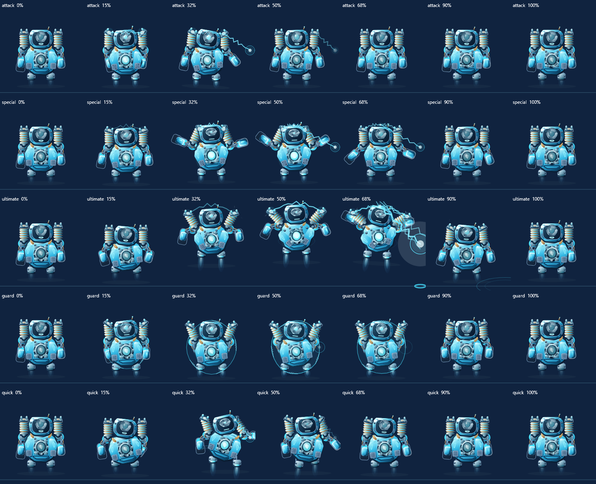
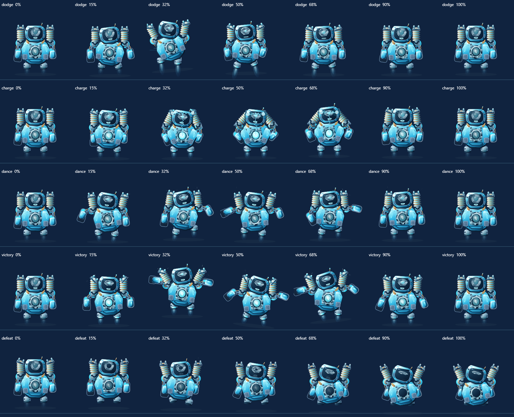
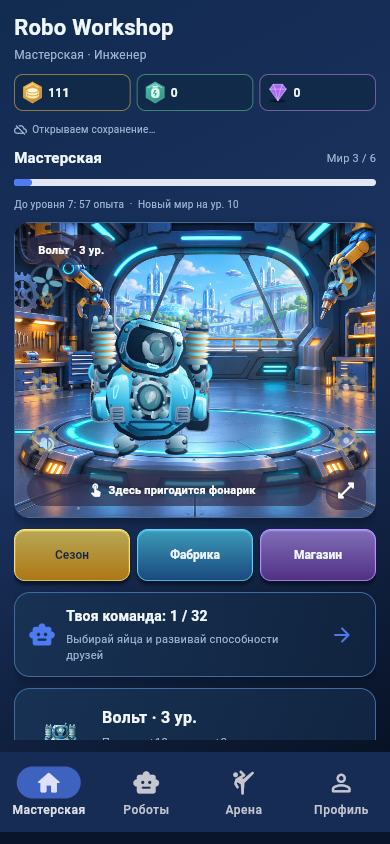
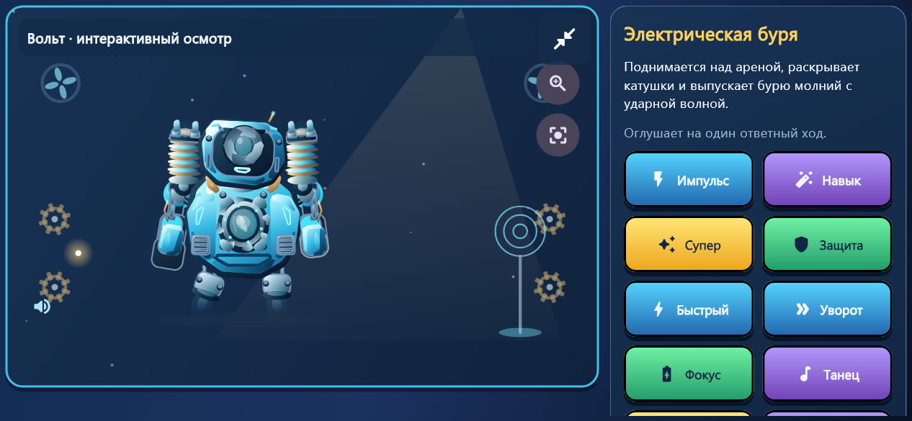

**Robo Workshop · Вольт: движения и музыка · тестовая сборка 0.2.0 (36)**

Вольт интегрирован в существующую мастерскую, осмотр и бой. Для десяти действий созданы отдельные наборы ключевых поз. Голова, экран, плечи, локти, ноги, стопы, поршни, катушки и реактор движутся независимо; временные сдвиги деталей создают инерцию. Прыжок начинается со сжатия подвески, приземление имеет отдельное восстановление. После импульса Вольт переходит в собственную стойку без остаточного движения универсальной атаки.

| Действие | Характер движения |
| --- | --- |
| Импульс | Короткая подготовка, поворот корпуса, односторонняя отдача и восстановление |
| Быстрая атака | Низкая стойка, встречные движения ног, рывок и короткий разряд |
| Навык | Подъём рук, дуга между катушками и направленный разряд |
| Электрическая буря | Сжатие подвески, подъём, раскрытие катушек, энергетическое поле, молнии, реакция камеры и приземление |
| Защита | Руки перед корпусом, движение энергии по оболочке, деформация поля и механическая отдача при попадании |
| Уворот | Отталкивание, боковой рывок, баланс руками и мягкое восстановление |
| Фокус | Спокойная поза, сведение энергии к реактору и синхронная пульсация катушек |
| Танец | Несколько механических шагов с независимыми движениями рук, головы и корпуса |
| Победа | Прыжки, поднятые руки, поворот и праздничные искры |
| Отключение | Потеря равновесия, опускание головы и рук, постепенное гашение реактора, катушек и лицевого экрана |

Семь реакций на касание выбираются из перемешиваемого набора без немедленного повтора: радость, прыжок, удивление, осмотр, игривый разряд, движение руками и танцевальный жест. Частые нажатия вызывают недовольство. Взгляд следит за указателем, а касание пола задаёт ограниченную платформой точку движения. Подтверждение награды из Python больше не заменяет выбранную на клиенте реакцию. Экипированное оружие остаётся видимым и используется в соответствующих атаках.

Причина обрыва победной мелодии находилась в короткоживущем контроллере звуков сцены: победа воспроизводилась как очередной эффект, с ограничением длительности и остановкой при смене сцены. Дополнительно стандартный Android audio focus у отдельных проигрывателей мог мешать друг другу. Теперь постоянный `GameMusic` живёт в корне приложения; `MusicDirector` управляет двумя переиспользуемыми голосами — фоном и победной композицией. Фон восстанавливается по реальному событию завершения музыки. Анимация, смена экрана и новый эффект не завершают композицию. Переходы громкости занимают около 180 мс; на паузе сохраняется позиция. Выключение звука сохраняется в настройках, отложенные победные мелодии после включения не накапливаются. Музыкой владеет один Android audio focus, эффекты его не перехватывают. Ненужный покадровый опрос позиции проигрывателей отключён.

В основном Flutter-клиенте с отдельным тестовым сохранением зафиксированы реальные события HTML media и громкость WebAudio. Первая победная композиция проиграла 4,003 секунды без остановки при импульсе и выходе из осмотра. Вторая возобновилась после паузы с позиции 1,226 секунды и дошла до завершения. Фон восстановился с сохранённой позиции; одновременно играла одна фоновая композиция. Измерены промежуточные уровни громкости от 0 до 0,115. Звук основного удара бури начинается с позиции 0,3 секунды существующего WAV, чтобы его предварительный разгон не сдвигал удар относительно анимации. Это наблюдение воспроизведения в браузере, без прослушивания динамика телефона.

Покадровое движение выполняется в Dart/Flutter и обновляет локальный `CustomPainter`. Python передаёт игровые события, а не координаты каждого кадра. Геометрия содержит 385 фигур, 522 узла, 199 общих путей и 174 материала; в v35 было 381/511/198/173. Новые опоры подвески, шарниры стоп, поршни и плечевые кольца связаны с реальными каналами движения. Кеш статических `ui.Picture` ограничен восемью цветами и 2 МиБ; для текущего цвета 34 группы занимают 56 240 байт. Одновременно рисуется не больше восьми молний, в режиме уменьшенных эффектов — четырёх. Невидимые и приостановленные сцены не продолжают цикл движения.

Парное измерение основного приложения в Windows/Chrome profile относительно исходников v35 (`6a866bdc91d7a144bbfd99409cdc54f331add872`): четыре прогревочных отчёта исключены; 25–26 перекрывающихся окон FrameTiming на сценарий; повторяющиеся vsync удалены при расчёте FPS.

| Сценарий | Медианный FPS v35 → v36 | Максимальный UI p95, мс | Максимальный raster p95, мс |
| --- | ---: | ---: | ---: |
| Мастерская, 390×844, DPR 3 | 80,1 → 89,1 | 12,8 → 11,4 | 13,0 → 12,8 |
| Бой, 844×390, DPR 2 | 83,2 → 85,7 | 17,9 → 10,2 | 11,7 → 11,0 |

Новых ошибок Flutter не зафиксировано. Минимальное окно FPS мастерской: 47,7 → 65,9; боя: 70,7 → 62,9. Это единичные прогоны на ПК в разное время; они не доказывают устойчивое ускорение или стабильные 60 FPS на Android.

Память измерялась по дереву процессов отдельного Chrome, включая браузер, GPU и служебные процессы. Максимальный RSS мастерской: 1 034,3 → 983,7 МиБ, боя: 1 037,9 → 983,9 МиБ. Private memory: 876,1 → 918,5 МиБ и 902,4 → 977,4 МиБ, то есть рост примерно на 4,8% и 8,3%. Нельзя приписать эту разницу только модели или считать её памятью Android-приложения. Три снимка за короткий прогон не устанавливают отсутствие утечек в долгой сессии. Ограничения кешей и голосов дополнительно проверяются тестами.

Запись команд Canvas в нативном тестовом движке Flutter, по 360 образцов на вариант:

| CPU, мс | v35 | v36 |
| --- | ---: | ---: |
| Без кеша: медиана / p95 | 0,416 / 0,660 | 0,474 / 0,873 |
| С кешем: медиана / p95 | 0,261 / 0,494 | 0,326 / 0,601 |

Дополнительные шарниры увеличили работу записи команд примерно на 0,065 мс по медиане с кешем. Кеш по-прежнему сокращает эту работу относительно отрисовки отдельных путей; это не замер GPU. Прогрев v36 занял 0,963 мс.

Область изменений проверена относительно v35: остальные 31 портрет, артборд, view model и строки способностей сохранены; все 46 прежних WAV и общий `game_robot.riv` совпадают побайтно. Три новых музыкальных OGG занимают в сумме 47 154 байта. `combat_rules.py`, `robot_arena.py` и `armory.py` совпадают с v35; серверная архитектура и баланс не менялись.

Прошли 295 Python-проверок: 285 успешно, 10 пропущены из-за отсутствия необязательного PostgreSQL. Нативные серии: 184 проверки движений, аудио, касаний, маршрутов и способностей; восемь проверок кеша; девять компоновок мастерской, осмотра и арены. Анализ восьми изменённых файлов Dart — без замечаний. Официальный Rive CLI: ноль ошибок и предупреждений. Сравнение Canvas с нативным эталоном Rive: IoU 0,99517, средняя ошибка RGB 5,296 при сохранённых порогах >0,9 и <24.

APK: 177 787 354 байта, SHA-256 `825a38afcab67bfdef84282e372c4a39be286bb5ad94b8f58c55b1babc746e68`. Прирост к v35 — 235 728 байт, около 230 КиБ или 0,13%. Проверены прежняя подпись, три ABI, 128 нативных библиотек с выравниванием 16 КБ, 82 ресурса персонажей/звука и 49 упакованных модулей Python. Импорт 18 основных модулей в CPython 3.14.7, чтение сохранения и публичный HTTPS health check с версией правил 3 успешны.

Подпись совпадает с v35 и позволяет обновить эту версию поверх установленной. У самого первого APK `apk-7d8231c` другая подпись; Android не разрешит такое обновление поверх него. Удаление приложения стирает локальные данные, поэтому для той старой версии сначала требуется отдельный перенос прогресса.

Касания проверены через настоящий указатель Chrome в основной игре с текущим скомпилированным клиентом: пять быстрых касаний дали ровно пять наград, пол и долгое удержание — ноль. Автоматический доход и кормление сохранились. Использовалось отдельное тестовое сохранение; пользовательские данные не открывались. В настройках VS Code команда Code Runner также приведена к синтаксису, работающему в CMD и PowerShell; используется Python проекта с установленными расширениями Flet.

[Тестовый релиз volt-v0.2.0-36](https://github.com/499jdkd/Robo-Workshop-Steel-Arena/releases/tag/volt-v0.2.0-36) публикуется с признаком prerelease, без замены последнего стабильного релиза. Инструмент публикации полностью скачивает открытый APK без авторизации и сравнивает SHA-256; результат сохраняется отдельно от исходного коммита. Численные результаты локальных проверок: [verification.json](docs/volt-v36/verification.json).

Физический Android не подключён. Стабильные 60 FPS, нагрев, длительная сессия и воспроизведение через динамик телефона пока не измерены. Следующая проверка на устройстве: установить этот APK поверх v35, проверить десять действий в осмотре и в бою, смену экранов во время победной мелодии и сворачивание приложения; записать Flutter profile frame timings и память на целевом телефоне. При недостаточной скорости сначала использовать уменьшенные эффекты, затем измерять GPU растеризацию — покадровый обмен с Python уже исключён.

Для воспроизведения: `tools/generate_volt_canvas.py --check`, `tools/check_music_playback.py --name <новое-имя>`, `tools/verify_main_game_release.py --build-number 36`, `tools/verify_volt_release.py --build-number 36`, `tools/check_packaged_python.py --build-number 36 --check-server`. Нативные тесты со снимками запускать последовательно: `--concurrency=1 --timeout=60s`.
