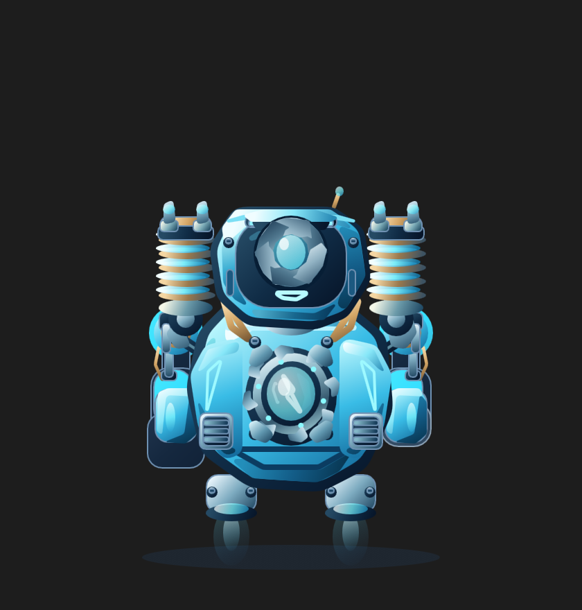
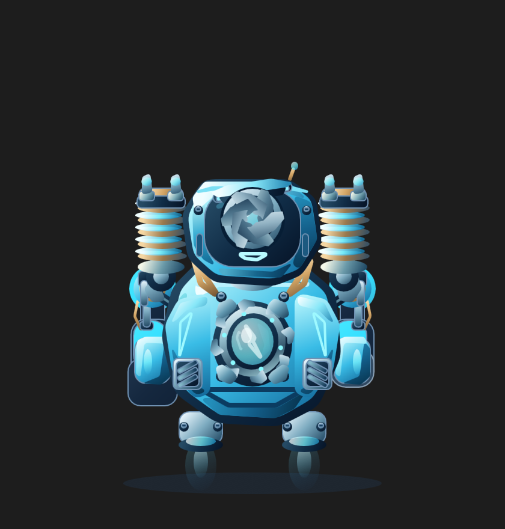
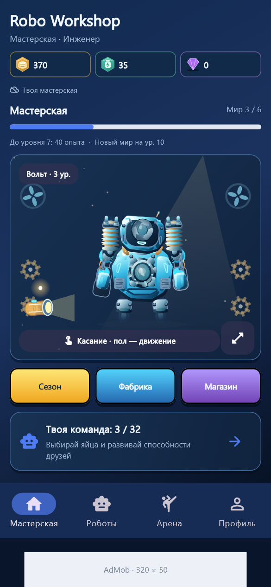

**Robo Workshop · Вольт и звуки персонажей · 0.2.0 (35)**

Вольт получил более подробную механику: объёмные панели с гранями и бликами, медные обмотки катушек, изоляторы, контактные клетки, поршни, кабели, радиаторы и защитное кольцо ядра. Векторный источник содержит 381 фигуру, 511 узлов, 198 уникальных путей и 173 материала; в v34 было 310 фигур. Раскрытие катушек, встречное вращение колец ядра, лепестки диафрагмы глаза, привод визора и жалюзи радиаторов двигаются независимо. При зарядке радиаторы открываются; при отключении энергия и движение механизмов затухают.

Для всех 32 роботов добавлены звуковые реакции на касания, движения, атаки и танец. Семь семейств голосов отличаются тембром; индивидуальные настройки меняют высоту, движение и силу звучания персонажа. В набор входят 18 новых коротких WAV общей величиной 193 954 байта, синтезированных без внешних сэмплов. Боевые звуки учитывают встроенную способность и экипированное оружие. Звуковой таймлайн следует фазе действия, поэтому перестроение интерфейса или очередное сообщение Python не запускает действие повторно. После отключения звука пропущенные сигналы не воспроизводятся задним числом.

Звук использует ограниченный ленивый кеш: до 12 проигрывателей и трёх одновременно звучащих голосов. Новое действие заменяет прерванную реакцию того же участника; каналы игрока и противника разделены. Запоздавшая загрузка, частые касания, пауза, выключение звука и уничтожение сцены проверены тестами на асинхронные гонки.

Покадровая анимация остаётся в Dart/Flutter, в локальном цикле сцены. Статические группы геометрии Вольта кешируются в `ui.Picture`, а шарниры, взгляд, энергия и оружие продолжают рисоваться с актуальной позой. Для одного цвета создаются 34 группы с 230 статическими фигурами, занимающие 58 304 байта. Кеш ограничен восемью вариантами цвета и двумя МиБ; обработка нехватки памяти освобождает его. При частичной прозрачности используется исходное наложение отдельных путей.

| Замер записи команд Canvas на CPU | Без кеша | С кешем |
|---|---:|---:|
| Медиана, мс | 0,416 | 0,261 |
| p95, мс | 0,660 | 0,494 |

Замер выполнен в нативном тестовом движке Flutter, по 360 образцов на вариант; прогрев занял 1,022 мс. Он измеряет работу CPU при записи команд и не устанавливает скорость GPU или FPS игры. Парное профилирование основного приложения до и после изменений ещё выполняется.

Проверка области изменений относительно исходников v34 (`141dbe3e4690fa58348d4b6ae08385d630eb70ed`) подтверждает сохранение остальных 31 портретов, артбордов, view model и строк способностей. Все 28 ранее существовавших звуков и общий `game_robot.riv` совпадают побайтно. `combat_rules.py`, `robot_arena.py` и `armory.py` также совпадают; боевые правила не корректировались.

Прошли 287 Python-тестов: 277 успешно, 10 пропущены из-за отсутствия необязательного локального PostgreSQL. Нативные серии проверили 158 случаев: 141 проверка звука, движений, касаний, маршрутов и способностей всех роботов, восемь проверок кеша и девять реальных компоновок основной игры. Анализ шести изменённых файлов Dart прошёл без замечаний. Совпадение силуэта Canvas с официальным нативным снимком Rive: IoU 0,9951, средняя ошибка цвета переднего плана 5,2861 при сохранённых порогах >0,9 и <24. Официальный Rive CLI проверил исходник без ошибок и предупреждений.

Парное измерение основной игры в Windows/Chrome profile относительно v34, после четырёх прогревочных отчётов, по 25–26 окнам на сценарий:

| Сценарий | Медианный FPS v34 → v35 | Максимальный UI p95, мс | Максимальный raster p95, мс |
| --- | --- | --- | --- |
| Мастерская, 390×844, DPR 3 | 92,1 → 86,8 | 12,4 → 12,2 | 9,5 → 15,2 |
| Бой, 844×390, DPR 2 | 99,9 → 103,1 | 9,3 → 8,2 | 5,7 → 9,0 |

Новых ошибок Flutter нет. Кеш сокращает работу Dart при записи команд, однако более подробная геометрия увеличила нагрузку растеризации. В мастерской медианный FPS снизился примерно на 5,7%; улучшение CPU нельзя считать ускорением всей сцены. Это одиночный замер на ПК с перекрывающимися окнами FrameTiming, а не доказательство скорости или стабильности Android.

APK 0.2.0 (35) собран: 177 551 626 байт, SHA-256 `fb5e31a3454469eb1948795c26569850afeeedddef977415b7386c917e2106b6`. Проверены прежняя подпись, три ABI, 128 нативных библиотек с выравниванием 16 КБ, 46 WAV и 79 ресурсов персонажей. Все 18 проверяемых упакованных Python-модулей импортируются в CPython 3.14.7; проверка сохранения и HTTPS-сервера с версией правил 3 успешна.

Касания проверены в основной игре с текущим скомпилированным Flutter-клиентом и отдельным тестовым сохранением: пять быстрых нажатий дали пять наград; касания пола и долгое удержание наград не дают. Сохранены автоматический доход и кормление. Пользовательское сохранение не открывалось. Это проверка Chrome на ПК, без запуска APK на Android.

Новый релиз: [volt-v0.2.0-35](https://github.com/499jdkd/Robo-Workshop-Steel-Arena/releases/tag/volt-v0.2.0-35). После создания тега выполняется полное публичное скачивание APK с проверкой SHA-256. Состояние и численные результаты хранятся в [verification.json](docs/volt-v35/verification.json).

Физический Android не проверен: подключённого устройства нет. Стабильные 60 FPS, нагрев и воспроизведение звука динамиком телефона не измерялись. Нативные тесты звука проверяют таймлайн и управление проигрывателями, а не субъективное качество прослушивания.

Воспроизведение проверок: `tools/generate_volt_canvas.py --check`, `tools/generate_robot_audio.py --verify-only`, `tools/verify_main_game_release.py --build-number 35`, `tools/verify_volt_release.py --build-number 35`. Нативные тесты со снимками запускать последовательно с `--concurrency=1 --timeout=60s`.
