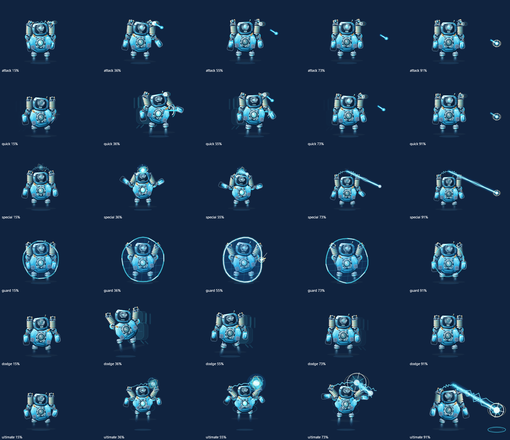
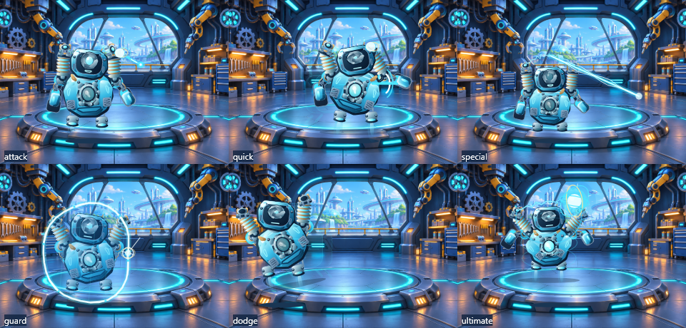

**Robo Workshop · Читаемость атак Вольта · тестовая сборка 0.2.0 (37)**

В v36 ограничитель сцены резервировал для Вольта 420 пикселей ширины под универсальное длинное оружие. В портретной сцене это почти полностью срезало уворот. Теперь для его корпуса и встроенных катушек используется отдельный габарит; экипированное оружие получает дополнительный запас перед роботом. Остальные персонажи используют прежние границы.

Уворот стал заметным боковым прыжком с наклоном, движением рук и ног, электрическим следом и двумя лёгкими контурами остаточного изображения. В осмотре шириной 320 логических пикселей он смещается более чем на 40 пикселей; в портретном бою — более чем на 22. Это проверяется через настоящий `GameSceneClock`, включая ограничитель сцены. Быстрый выпад уходит вперёд более чем на 45 пикселей, а обычный импульс сопровождается отдачей назад.

| Действие | Что теперь видно |
| --- | --- |
| Импульс | Выдвигается и поворачивается встроенная фокусирующая головка катушки; загорается апертура, появляются кольца на выходе, летит компактный электрический сгусток и вспыхивает попадание |
| Быстрая атака | Сжатие подвески, выраженный выпад всем корпусом, контуры движения, короткий ударный серп и разряд; сохраняется более короткая длительность |
| Навык | Две катушки питают отдельный заряд с вращающимися кольцами, затем выходит широкий луч с белым сердечником и двумя подвижными лентами |
| Защита | Более крупная яркая оболочка, движущаяся сетка энергии, светящиеся участки края, деформация, вспышка и отражённый след при попадании |
| Уворот | Видимое боковое смещение, отталкивание, наклон, разнесённые руки и ноги, электрические следы и восстановление |
| Электрическая буря | Крупная сфера накопления, вращающиеся удерживающие кольца, подпитка от катушек, схлопывание заряда, мощный луч с ветвями, попадание и ударная волна |

Верхняя граница учитывается при размещении сферы: во время подъёма она перемещается вперёд и сохраняется внутри короткой сцены. Лицевой экран остаётся видимым. Встроенные фокусирующие головки имеют отдельные телескопические каретки, поворот, контактные губки, металлические кольца и светящуюся апертуру. Это часть катушек, экипированное оружие продолжает отображаться. Геометрия Вольта: 409 фигур, 554 узла, 206 общих путей, 181 материал.

Боевые правила не менялись. Щит снижает обычный входящий урон на 72% с округлением, если не действует EMP и атака не пробивает защиту. Уворот избегает одного попадания; серия может попасть оставшимися ударами. В осмотре у щита есть демонстрационный входящий снаряд, чтобы реакция на попадание была видна без противника. В настоящем бою она определяется боевым событием.

Звуки выстрела, луча и попадания привязаны к фазам действий. Звук попадания перенесён к достижению цели, поэтому он больше не обрезает основной звук электрической бури. Используются существующие записи. Все 46 WAV и три музыкальных OGG сохранены побайтно; постоянный музыкальный контроллер v36 сохранён.

Новые эффекты работают на локальном цикле Dart/Flutter. Количество молний ограничено восемью, в уменьшенном режиме — четырьмя; лучи, кольца и остаточные контуры состоят из ограниченного числа векторных команд. Новых таймеров, последовательностей изображений, слоёв размытия и покадровых сообщений Python нет. В уменьшенном режиме сохраняются основные формы заряда, луча и щита.

Чтобы проверить на телефоне, установите v37 поверх v35 или v36, откройте осмотр Вольта и по одному нажмите шесть действий из таблицы. Затем сравните их в тренировочном бою. Повторите супер несколько раз, смените экран во время победной музыки, сверните приложение и вернитесь. Проверьте обычный и уменьшенный режим эффектов. Перезапуск телефона не требуется. Сравнивайте заметность движения, заряд до выстрела, сам выстрел и попадание, отсутствие обрезанных эффектов и рывков. Такая проверка не измеряет точный FPS.

Физическое Android-устройство не подключено; частота кадров, нагрев, долгие сессии и звук динамика телефона пока не измерены. Для подтверждения 60 FPS нужен замер Flutter FrameTiming в profile-сборке на целевом устройстве. Приведённые ниже замеры ПК относятся только к этому компьютеру.
Парные замеры основной игры на ПК (Windows, Chrome, Flutter profile), v36 → v37:

| Сцена | Медианный FPS | Максимальный UI p95, мс | Максимальный raster p95, мс |
| --- | ---: | ---: | ---: |
| Мастерская, 390×844, DPR 3 | 87,7 → 87,8 | 10,0 → 10,9 | 12,0 → 11,5 |
| Бой, 844×390, DPR 2 | 90,7 → 88,1 | 9,5 → 9,8 | 10,4 → 10,6 |

Медиана боя снизилась примерно на 2,9%; мастерская почти не изменилась. Ошибок Flutter нет. Это одиночные прогоны по 25–26 перекрывающимся окнам, после исключения четырёх прогревочных отчётов и повторяющихся vsync. По этим данным нельзя подтверждать Android FPS или статистически устойчивую разницу.

Пиковый RSS дерева Chrome: мастерская 1 209,3 → 1 062,5 МиБ, бой 1 034,5 → 1 003,9 МиБ. Private memory: 969,8 → 962,2 МиБ и 964,2 → 978,8 МиБ. Измерение включает браузер, GPU и служебные процессы; это не память Android-приложения и не длительный тест утечек.

Нативная запись команд Canvas на CPU, по 360 образцов: с кешем медиана 0,298 мс, p95 0,413 мс; без кеша 0,456 / 0,613 мс. Для текущего цвета кешируются 36 групп, 246 фигур, 63 008 байт; лимиты по-прежнему восемь цветов и 2 МиБ. Это замер CPU записи команд, а не скорости GPU.

Проверки: 295 Python (285 успешно, 10 необязательных PostgreSQL пропущены); 190 отдельных нативных проверок движений, звука и взаимодействий; восемь проверок кеша; девять компоновок основной игры. В их числе — реальные границы сцены при увороте и выпаде на ширине 320 пикселей, различие компактного импульса и широкого луча, уменьшенный режим и снимки поверх настоящего яркого фона мастерской. Анализ четырёх файлов Dart прошёл без замечаний. Rive CLI: ноль ошибок и предупреждений. Сравнение с официальным нативным эталоном: IoU 0,99515, ошибка RGB 5,217 при прежних порогах >0,9 и <24.

В основном Flutter-клиенте победная композиция проиграла 4,002 секунды без остановки при выстреле и смене экрана. Вторая мелодия возобновилась с позиции 1,277 секунды и завершилась. Одновременно играл один фон; плавные переходы громкости и начало звука бури с позиции 0,3 секунды сохранены. Это наблюдение событий проигрывателей в браузере без прослушивания динамика телефона.

Проверка настоящим указателем в основной игре с отдельным сохранением: касание пола переместило Вольта и не дало награду, длительное удержание также дало ноль. Пять быстрых касаний перемещённого робота записались как пять наград; автоматический доход и кормление сохранились. Пользовательское сохранение не открывалось. Точка ввода следует видимому роботу после перемещения, а не его прежнему положению в центре.

APK 0.2.0 (37): 177 869 614 байт, SHA-256 `cffb7649cfa00699a448d0e523a748de956c942766c1ee35b90bf252f2f845df`. Прирост к v36 — 82 260 байт, около 80,3 КиБ или 0,046%. Проверены прежняя подпись v35/v36, три ABI, 128 нативных библиотек с выравниванием 16 КБ, 82 ресурса и 49 упакованных модулей Python. Импорт основных модулей в CPython 3.14.7, чтение сохранения и публичный HTTPS health check с версией правил 3 успешны.

Исходники сравнивались с v36 (`70f7013068d7c7d6672f348fabfa2b1b7e670863`): прочие 31 портрет, артборд, view model и строки способностей сохранены. Общий Rive-файл, боевые правила и все 49 аудиофайлов совпадают с v36. Сервер не менялся. Нативные бинарники всех трёх ABI содержат новые каналы кареток излучателей.

Сборка публикуется как [тестовый релиз volt-v0.2.0-37](https://github.com/499jdkd/Robo-Workshop-Steel-Arena/releases/tag/volt-v0.2.0-37), без замены последнего стабильного релиза. Публикация включает полное скачивание открытого APK без авторизации и сверку SHA-256; итоговая квитанция сохраняется отдельно от исходного коммита. Подробные данные: [verification.json](docs/volt-v37/verification.json).
