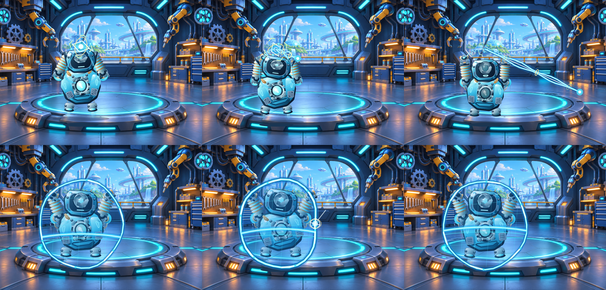

**Robo Workshop · Навык и щит Вольта · 0.2.0 (39), тест**

Навык Вольта получил собственную последовательность: руки и катушки готовят заряд, над излучателями собирается вращающаяся гранёная линза, затем выходят два переплетающихся электрических потока. По ним проходят световые кольца. Линза остаётся видимой во время выпуска энергии; после отдачи механизмы плавно возвращаются в исходное положение. Обычный импульс и одобренная суперспособность v38 сохранены.

У щита усилены голубое заполнение, многослойный контур и белая кромка. Внутри движется широкая световая полоса с тонкой второй линией. Полоса ограничена оболочкой и проходит ниже лица. В уменьшенном режиме сохраняются основной контур и внутренняя полоса. При попадании остаются деформация оболочки, локальная вспышка и отбитый заряд. Полоса — визуальная часть поля; новая шкала прочности или отдельная механика щита не добавлялась.

Изменены только два действия Вольта в трёх файлах Dart. Эффекты используют существующий локальный цикл Flutter и ограниченное число путей и колец, без новых таймеров, размытия или покадровых сообщений Python. Геометрия и портреты всех 32 роботов, 49 аудиофайлов, музыка, правила боя, сервер и сохранения прежние. Звуки навыка синхронизированы с существующими фазами подготовки и выпуска. Одобренные фазы супера, его размер, звук, отдача и камера сохранены.

До изменений сохранены 33 контрольных кадра v38: девять других действий в трёх фазах и супер в шести фазах. После изменений их RGBA-пиксели совпали полностью. Проверяется также сохранность остальных столбцов более раннего эталона v37. Отдельная проверка подтверждает наличие и движение яркой полосы внутри щита при уменьшенных эффектах; проверка навыка отличает широкий канал от компактного импульса на ширине 320 пикселей. Иллюстрация выше — нативные кадры Flutter на реальном фоне мастерской, увеличенные вдвое для осмотра, не запись с Android.

При подготовке сборки обнаружена открытая служебная папка `src/.flet`. Она теперь исключается из копирования и манифеста входных файлов. Проверка сборочного инструмента подтверждает, что локальное сохранение не копируется, не меняется и не влияет на повторное использование подготовленной сборки. Открытая игра и её данные не затрагивались.

Прошли 298 Python-проверок: 288 успешно, 10 пропущены из-за отсутствия необязательного PostgreSQL. Успешны 199 проверок анимаций, взаимодействий и аудио Flutter и 173 проверки компоновки существующих экранов, всего 372 нативных случая. Анализ трёх изменённых файлов Dart — без замечаний. Реальные касания в основном клиенте дали пять наград за пять нажатий; пол и удержание — ноль. Доход и автоматическое кормление сохранились, пользовательское сохранение не открывалось.

В реальном основном клиенте две победные композиции дошли до конца. Первая играла 3,981 секунды, вторая восстановилась после паузы с позиции 1,043 секунды. Одновременно работал один фон; плавные переходы громкости сохранились. Существующий звук супера начал воспроизведение с позиции 0,305 секунды. Это проверка событий проигрывателя в браузере, без прослушивания динамика телефона.

APK 0.2.0 (39): 177 902 426 байт, всего на 48 байт больше v38. SHA-256 `456c957698a0811db1303b43a719beacb6ff45a85b08ef766f1df8b12800eb91`. Подпись совпадает с v35–v38; проверены три ABI, 128 нативных библиотек с 16-КБ выравниванием, 82 ресурса и 49 модулей Python. Импорты CPython 3.14.7, чтение сохранения и HTTPS сервера успешны. Во всех трёх `libapp.so` появились новые функции линзы и двойного разряда; бинарные файлы отличаются от v38.

Повторение только навыка или только щита в основном приложении, Windows/Chrome profile, 390×844, DPR 3. Первые четыре отчёта исключены из каждого прогона, повторные vsync не учитывались в FPS:

| Сценарий | Медиана FPS v38 → v39 | Минимальное окно FPS v38 → v39 | Максимальный UI p95, мс v38 → v39 | Максимальный raster p95, мс v38 → v39 |
| --- | ---: | ---: | ---: | ---: |
| Навык | 64,8 → 65,0 | 54,1 → 26,4 | 11,7 → 16,9 | 13,3 → 28,6 |
| Щит | 65,0 → 60,6 | 49,2 → 43,7 | 12,5 → 13,7 | 16,5 → 15,6 |
| Навык, повтор | 67,6 → 87,2 | 53,6 → 40,8 | 14,4 → 12,3 | 17,0 → 18,1 |

В первом прогоне нового навыка просадка пришлась на первое оставшееся после прогрева окно, следующее дало 47,3 FPS, дальнейшие — не ниже 50. Для проверки выполнен один дополнительный парный прогон навыка: такого же пика не было, короткие просадки сохранились. Оба исходных результата сохранены. Разброс между прогонами не позволяет приписать изменения скорости только новым эффектам. Эти прогоны с перекрывающимися окнами не подтверждают стабильные Android 60 FPS, отсутствие утечек или температурную устойчивость. Ошибок Flutter во всех шести захватах нет. Память в численном отчёте включает дерево Chrome, GPU и служебные процессы, не только игру.

На телефоне установите v39 поверх v35–v38, выберите Вольта и сравните «Импульс» и «Навык» в осмотре. У навыка должна быть отдельная линза и двойной продолжительный разряд. Нажмите «Защита»: яркая кромка и внутренняя полоса щита должны быть видны на фоне мастерской. Повторите в тренировочном бою кнопкой «Щит», затем включите уменьшенные эффекты. Супер должен выглядеть как в v38. Подключённого физического Android нет; плавность, нагрев и звук динамика требуют проверки на устройстве.

Численные результаты сборки и проверок: [verification.json](docs/volt-v39/verification.json). Тестовый релиз: [volt-v0.2.0-39](https://github.com/499jdkd/Robo-Workshop-Steel-Arena/releases/tag/volt-v0.2.0-39).

Воспроизведение: `tools/verify_main_game_release.py --build-number 39`, `tools/verify_volt_release.py --build-number 39`, `tools/check_packaged_python.py --build-number 39 --check-server`. Для парного замера используются `tools/run_volt_profile_comparison.py --scenarios skill shield` с клиентами v38/v39. Нативные тесты запускать последовательно, `--concurrency=1 --timeout=60s`.
