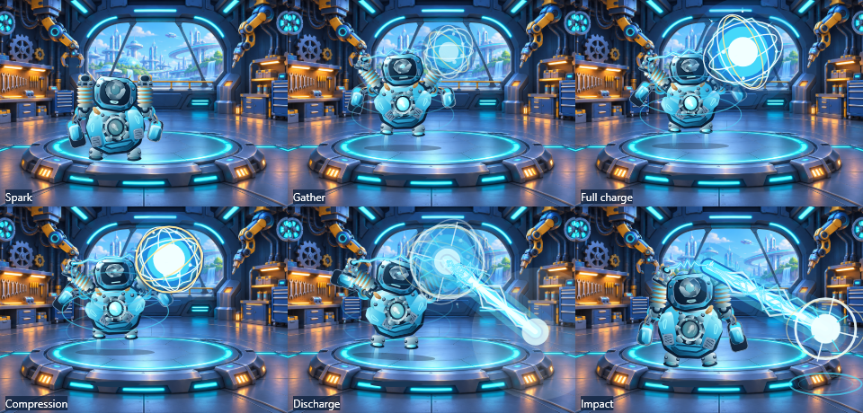

**Robo Workshop · Усиленная электрическая буря Вольта · 0.2.0 (38), тест**

Обновление касается суперспособности Вольта. Энергия начинается с небольшой искры, собирается в крупное ядро, сжимается перед выстрелом и переходит в широкий разряд с ударной волной. Остальные действия, геометрия всех персонажей и боевые правила сохранены.

Радиус заряда растёт от 7 до 86 единиц рига: максимум почти вдвое больше радиуса сферы v37. Четыре удерживающих кольца вращаются в разных плоскостях, электрическая корона и восемь втягиваемых частиц показывают накопление. Катушки раскрываются сильнее, каретки излучателей выдвигаются, реактор и охлаждающие панели работают независимо. В фазе напряжения корпус и руки ненадолго удерживают позу, а заряд сжимается примерно до радиуса 72.

Разряд получил широкий световой канал, яркое ядро и четыре движущиеся ленты. Основная полоса выросла с 12 до 31 единицы рига, белый сердечник — с 4,8 до 12. На попадании появляются крупная вспышка и расширяющиеся кольца; радиус наземной ударной волны увеличен до 260 единиц. Реакция камеры усилена только для этого супера. Существующая запись удара воспроизводится со скоростью 0,82; новые аудиофайлы не добавлялись. Музыкальный контроллер сохранён.

Время выпуска энергии и попадания осталось на прежних границах 0,62 и 0,90 нормализованного действия. Урон, расход энергии, оглушение, противники и сервер не менялись. Размер ядра и колец учитывается при размещении в короткой сцене; проверены портретные и альбомные размеры и оба направления взгляда. В уменьшенном режиме остаются крупный заряд, два удерживающих кольца и основной разряд, отключается тряска камеры.

Все эффекты работают на локальном цикле Dart/Flutter. Рост, сжатие, выброс и попадание вычисляет один `VoltStorm`; новых таймеров и покадровых сообщений Python нет. Число частиц, колец, лент и сегментов молний ограничено, размытие и дополнительные слои `saveLayer` не используются. Изменений RML, портретов, общего Rive-файла и существующих 49 аудиофайлов нет.

До изменения кода были сохранены 30 контрольных кадров v37 — десять других действий в трёх фазах. После изменения их RGBA-пиксели совпали полностью. Отдельные проверки подтверждают рост заряда, сжатие перед выстрелом, удержание позы, достаточный размер ядра относительно навыка на ширине 320 пикселей и сохранение границ сцены. Это нативные снимки Flutter, не запись с Android.

Для проверки установите v38 поверх v35, v36 или v37, откройте осмотр Вольта и нажмите «Супер». Затем повторите в тренировочном бою и в уменьшенном режиме эффектов. На телефоне ещё требуется измерить FPS, нагрев и звук динамика: подключённого Android-устройства нет. Нативный ролик для визуальной проверки экспортирован с частотой 30 кадров/с; это частота экспорта, а не измеренная скорость игры.
Прошли 297 Python-проверок: 287 успешно, 10 пропущены из-за отсутствия необязательного PostgreSQL. Нативная серия Flutter проверила 196 случаев, дополнительно прошли девять компоновок основной игры. Анализ пяти файлов Dart — без замечаний. Проверка области изменений подтверждает сохранность геометрии всех 32 роботов, общего Rive-файла, 49 аудиофайлов и боевых правил. Дополнительные проверки режима `animation_only` отклоняют изменения портрета и артборда Вольта.

В основном клиенте победная мелодия проиграла 4,002 секунды через выстрел и смену экрана; вторая восстановилась после паузы с позиции 1,309 секунды и завершилась. Одновременно играл один фон, плавные переходы громкости сохранились. Основной звук бури начинается с прежней позиции 0,3 секунды существующего WAV. Это проверка событий проигрывателей в браузере; динамик телефона не прослушивался.

APK 0.2.0 (38): 177 902 378 байт, SHA-256 `09edbd3e8c9a20c8a7d7e42aeaa4453aa6f7419c41046b26faa8e22a7fccc743`. Прирост к v37 — 32 764 байта, около 32 КиБ или 0,018%. Проверены прежняя подпись, три ABI, 128 нативных библиотек с выравниванием 16 КБ, 82 ресурса и 49 модулей Python. Импорты основных модулей в CPython 3.14.7, чтение сохранения и публичный HTTPS health check с версией правил 3 успешны.
Повторение только суперспособности в основном приложении, Windows/Chrome profile, 390×844, DPR 3, v37 → v38:

| Показатель | v37 | v38 |
| --- | ---: | ---: |
| Медианный FPS | 107,7 | 99,0 |
| Минимальное окно FPS | 81,6 | 74,7 |
| Максимальный UI p95, мс | 7,0 | 7,0 |
| Максимальный raster p95, мс | 11,9 | 14,1 |
| Максимальный RSS дерева Chrome, МиБ | 1 434,8 | 1 467,5 |
| Максимальный private memory, МиБ | 1 346,8 | 1 370,4 |

Медианный FPS снизился примерно на 8%; время растеризации увеличилось на 2,2 мс. Размер и слои нового заряда создают дополнительную работу отрисовки. Это по 26 перекрывающихся окон одного прогона, первые четыре прогревочных отчёта исключены; повторяющиеся vsync исключены из FPS. Ошибок Flutter не зафиксировано. Память включает браузер, GPU и служебные процессы, а не только игру. Такой замер не подтверждает Android 60 FPS, нагрев или отсутствие утечек в долгой сессии.

Уменьшенный режим оставляет крупное ядро и главный луч, сокращает удерживающие кольца до двух и отключает дополнительные ленты, часть частиц и реакцию камеры. Значения урона и фазы попадания от режима эффектов не зависят.

Проверка указателем в основной игре: пять касаний перемещённого Вольта дали пять наград; касание пола и удержание — ноль. Доход и кормление сохранились, пользовательское сохранение не открывалось.

[Тестовый релиз volt-v0.2.0-38](https://github.com/499jdkd/Robo-Workshop-Steel-Arena/releases/tag/volt-v0.2.0-38) публикуется как prerelease, без замены последнего стабильного релиза. Инструмент публикации полностью скачивает APK по открытой ссылке без авторизации и сверяет SHA-256; итоговая квитанция сохраняется отдельно от исходного коммита. Численные данные: [verification.json](docs/volt-v38/verification.json).

Воспроизведение: `tools/verify_main_game_release.py --build-number 38`, `tools/verify_volt_release.py --build-number 38`, `tools/check_packaged_python.py --build-number 38 --check-server`. Для замера повторных суперов в `tools/run_volt_profile_comparison.py` используется `--scenarios ultimate`; для сценария осмотра в `tools/profile_interactive_game.py` — `--mode robot --showcase-action ultimate`. Нативные проверки запускать последовательно с `--concurrency=1`.
