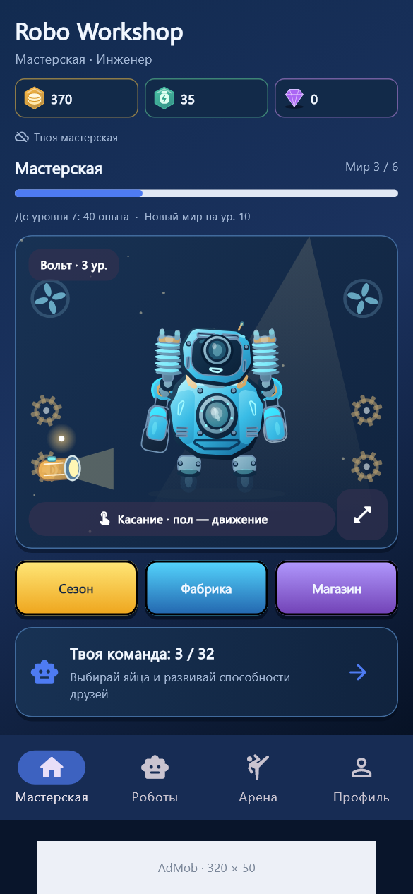

**Robo Workshop · Вольт · 0.2.0 (34)**

[GitHub Release](https://github.com/499jdkd/Robo-Workshop-Steel-Arena/releases/tag/volt-v0.2.0-34) · [APK](https://github.com/499jdkd/Robo-Workshop-Steel-Arena/releases/download/volt-v0.2.0-34/Robo-Workshop-Volt-v34.apk)

Изменён только персонаж Вольт. Голубой силуэт и две катушки сохранены; добавлены механический корпус с объёмными панелями, шарниры, контакты, ядро, манипуляторы, сопла и выразительный визор. Авторский векторный источник содержит 310 фигур, включая скрытые варианты экипированного оружия. Модель компилируется в кешируемые пути и материалы Flutter CustomPainter. Остальные 31 портрет, набор способностей, артборд и view model проверены на совпадение со снимком до этой задачи. Общий `.riv` не изменён.

В мастерской и осмотре работают радость, прыжок с подготовкой и приземлением, удивление, недовольство частыми касаниями, взгляд за пальцем, движение к выбранной точке, электрический выстрел по мишени, танец и осмотр собственных механизмов. Удержание показывает бурю. Прерванные действия смешивают позы корпуса, головы и катушек; движения не сводятся к перемещению целой картинки.

| Действие | Анимация Вольта |
|---|---|
| Атака | Короткий электрический импульс из катушек, подготовка и отдача |
| Быстрый | Сжатие подвески, рывок и короткий разряд |
| Навык | Раскрытие контактов, заряд и межкатушечная дуга, разряд в цель |
| Защита | Электрическая сфера вокруг корпуса |
| Уворот | Боковой рывок с электрическим следом |
| Фокус | Катушки сближаются и передают энергию ядру |
| Электрическая буря | Подъём, раскрытие катушек, накопление, молнии, вспышка и ударная волна |
| Победа | Подвижная радость, жесты и искры |
| Поражение | Угасание ядра, катушек и сопел, дым, остановка ротора и грустный визор |

Осмотр закрытого Вольта доступен без изменения ресурсов, экипировки или сохранения. Его панель показывает десять демонстрационных действий. В настоящем бою отображается выбранное установленное оружие, включая чередование двух креплений и серверное оружие PvP. Встроенные электрические приёмы используют катушки, а не универсальную пушку.

Добавлены четыре оригинальных коротких звука катушек: импульс, заряд, буря и отключение. Их маркеры выполняются нативным таймлайном, проверены при 30/60/120 Hz и не повторяются при пропуске кадра. Файлы PCM16 mono 22 050 Hz проверены на отсутствие клиппинга и щелчков на концах; прослушивание на физическом устройстве не проводилось.

В мастерской и осмотре Вольт больше не ожидает загрузки Rive: первый кадр рисует собственный локальный Ticker. На кадрах нет `setState`, Flet-событий или Python-координат. Перерисовывается сцена. Пауза, скрытие и уход приложения в фон останавливают цикл и звук; возврат обнуляет накопленное время. В арене остальные бойцы продолжают использовать прежние Rive-модели.

По новым видео от 19 ноября исправлено наложение при переходах: профиль → мастерская около 0:22, мастерская → коллекция около 0:48 и вход в арену в коротком ролике. Причина — исходящий слой AnimatedSwitcher оставался на секунду через `reverse_duration`, несмотря на `duration=0`. Корневой экран теперь заменяется одним непрозрачным контейнером. Проверка старого варианта воспроизводит наложение; новый проходит быстрые переключения уже на следующем кадре.

Правила боя, сохранений и сервер не менялись. Проверки повторного ввода, отмены, низкой/нулевой энергии и реального выбранного оружия проходят. 600 синтетических тренировочных боёв Вольта дали 598 побед и два поражения на поздних боссах при уровне 1; зависаний не было. Показанный в видео противник с большим перевесом HP относится к экспертному режиму. Общий баланс оставлен прежним.

Парное профилирование одной и той же основной игры на Windows/Chrome, по 25–26 окон после четырёх начальных отчётов:

| Сценарий | Медиана FPS: до → после | Максимальный UI p95, мс | Максимальный raster p95, мс |
|---|---|---|---|
| Мастерская · 390×844, DPR 3 | 101.2 → 91.9 | 14.5 → 12.7 | 5.6 → 10.2 |
| Бой · 844×390, DPR 2 | 117.9 → 94.7 | 6.5 → 11.0 | 3.0 → 7.4 |

В мастерской первый кадр после создания синтетической сессии: 2,37 → 0,34 с. Время прогрева модели — 3,4 мс; `.riv` для него не загружался. Более подробная геометрия увеличила стоимость рисования и уменьшила медиану FPS. Это один парный сценарий на ПК с перекрывающимися окнами FrameTiming, а не замер запуска Android, устойчивости нагрева или FPS телефона. Повторяющиеся записи vsync исключены из расчёта FPS.

Проверки: 282 Python-теста, 272 успешно и 10 пропусков необязательного локального PostgreSQL; 130 нативных сценариев анимаций/жестов и девять размеров основной разметки. В общем параллельном прогоне одна операция получения PNG зависла; все восемь проверок первого кадра и быстрого пути повторно прошли последовательно с сохранением PNG. Точная причина параллельного зависания не установлена. Кликер проверен настоящим Flet-сервером и собранным Flutter-клиентом на изолированном сохранении: пол и удержание не начисляют ресурсы, пять быстрых касаний учитываются ровно пять раз, кормление сохранено. Реальное пользовательское сохранение не открывалось.

APK проверен по составу, подписи, трём ABI, библиотекам с выравниванием 16 КБ, новым звукам и маркерам Canvas во всех `libapp.so`. Модули Python из APK импортированы в CPython 3.14.7; отдельно проверен HTTPS действующего сервера. SHA-256: `e33a20f03436c78c3fe3a38484877c679b6683e17b12a3f71ada368e691b27a7`.

**Физический Android не проверен:** подключённых ADB-устройств нет. Цель 60 FPS, реальный звук, нагрев, системные жесты и возврат из настоящей рекламы на телефоне остаются для проверки устройства. В APK сохранены тестовая реклама Google и прежний тестовый режим премиальной линии.

Подпись совпадает с локальными v31/v32, поэтому их данные должны сохраняться при обычном обновлении. Старый публичный APK versionCode 1 подписан другим ключом; установка поверх него этой подписью невозможна. Удалять установленную игру ради обновления не следует: для такого перехода нужен исходный ключ или отдельный перенос сохранения.

Воспроизведение: `tools/generate_volt_canvas.py --check`, `tools/generate_volt_audio.py --verify-only`, `tools/volt_quality_audit.py`, `tools/verify_main_game_release.py --build-number 34`, `tools/verify_volt_release.py --build-number 34`. Нативные тесты с получением PNG запускать с `--concurrency=1 --timeout=60s`. Полные локальные доказательства находятся в `build/volt-verification-v34/summary.json`.
